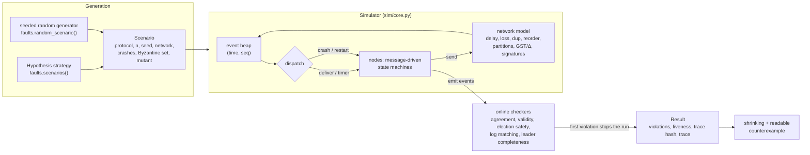
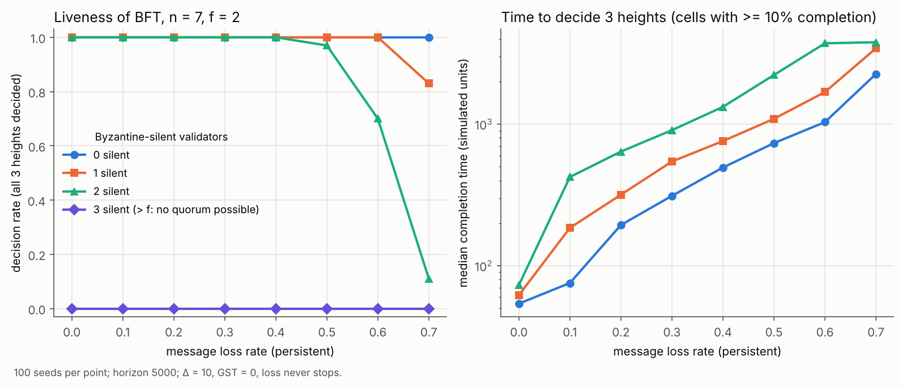

# consensus-robustness

A deterministic, seedable discrete-event simulator for **testing the safety and liveness of
consensus protocols under faults**, with property-based fault injection (Hypothesis), automatic
shrinking of counterexamples, and mutation testing of the test harness itself.

Two protocols are implemented from their papers:

* **Raft** (crash-fault tolerant, `n = 2f + 1`): leader election and log replication
  (Ongaro–Ousterhout 2014, Figure 2).
* **A Tendermint-style BFT protocol** (Byzantine-fault tolerant, `n = 3f + 1`, quorums `2f + 1`):
  propose / prevote / precommit with locking (Buchman–Kwon–Milosevic 2018, Algorithm 1), attacked by
  silent, equivocating and garbage-spewing Byzantine nodes.

## Motivation

A consensus protocol is correct if it is **safe** in *every* execution (no two correct nodes ever
decide differently) and **live** under the timing assumptions it was designed for (it eventually
decides once the network behaves). The executions that break protocols are rare interleavings: a
leader that crashes right after replicating to one follower, a vote delayed past the next election,
an equivocating validator plus a partition. This project makes such executions *reproducible*
(one integer seed fixes everything), *searchable* (Hypothesis generates fault schedules), and
*explainable* (a failing schedule is shrunk to a few faults and printed as a short trace).

## Architecture



| module | role |
|---|---|
| `sim/core.py` | event queue with simulated integer time; nodes; crash/restart with incarnation epochs; SHA-256 trace hash |
| `sim/network.py` | delay distributions (uniform, exponential, bimodal), loss, duplication, reordering, partitions with healing, slow links, partial synchrony (GST, Δ) |
| `protocols/raft.py`, `protocols/bft.py`, `protocols/byzantine.py` | protocols, deliberately broken *mutants*, Byzantine strategies |
| `checking/properties.py` | safety invariants checked online, at the event that would break them |
| `scenario.py` | serialisable experiment description, runner, liveness evaluation, counterexample printer |
| `faults.py` | Hypothesis strategy and seeded random generator for fault schedules |
| `mutation.py`, `sweep.py`, `experiment.py`, `cli.py` | mutation testing, seed sweeps, statistics, CLI |

**Determinism.** All randomness comes from `random.Random` instances seeded with strings derived
from the scenario seed (CPython hashes string seeds with SHA-512, independent of `PYTHONHASHSEED`);
ties in the event heap are broken by insertion order. Tests check that equal seeds give identical
trace hashes, also across processes with different `PYTHONHASHSEED`.

**Timing model** (Dwork–Lynch–Stockmeyer 1988). Before `GST` messages may be lost, duplicated,
partitioned, or delayed adversarially (but are delivered by `GST + Δ` if not lost); after `GST` every
message arrives within `Δ`. Liveness is demanded only if at most `f` nodes are faulty (Byzantine, or
down at the stabilisation time `T* = max(GST, last crash/restart)`), and then within `T* + 2000`.

## Protocols

Precise rule sets: [`docs/raft.md`](docs/raft.md) and [`docs/bft.md`](docs/bft.md).

* **Raft.** Randomised election timeouts. A server votes at most once per term, and only for a
  candidate whose log is at least as up-to-date as its own. The leader replicates with
  AppendEntries (consistency check on `prevLogIndex/prevLogTerm`, truncation of conflicting suffixes)
  and commits an index once a majority stores it, **but only for entries of its own term**. A no-op
  entry at the start of each term lets older entries commit. `currentTerm`, `votedFor` and the log
  survive crashes.
* **Tendermint-style BFT.** Heights of rounds. In each round a rotating proposer proposes, then nodes
  *prevote* and *precommit*. `2f + 1` prevotes for `v` (a "polka") make a node *lock* on `v` and
  precommit it; `2f + 1` precommits decide. A locked node prevotes another value only if the proposal
  carries a newer polka. Round timeouts grow linearly, and `f + 1` messages from a higher round make
  a node skip ahead. Signed messages are relayed (gossip), and nodes that fall behind catch up via
  decision certificates.
* **Byzantine behaviours** (BFT): `silent`; `equivocate` (a coordinated coalition that sends
  conflicting proposals and votes to two groups of honest nodes); `garbage` (random, malformed, forged
  or ill-typed messages).
* **Mutants** (deliberately broken variants for mutation testing): BFT `quorum_2f`, `n_eq_3f`,
  `no_lock`; Raft `no_log_check`, `stale_votes`, `small_quorum`, `commit_old_term`.

## Properties checked

| protocol | safety (online) | liveness (after the run) |
|---|---|---|
| Raft | election safety, log matching, leader completeness, state-machine safety, validity | all client commands applied on all live nodes by `T* + 2000` |
| BFT | agreement, validity (`valid(v)`), integrity | every live honest node decides all heights by `T* + 2000` |

On a violation the run stops, and `Result.counterexample()` prints the fault schedule followed by
the protocol-level events (elections, votes, locks, decisions, crashes) that lead to it.

## The mathematics

[`docs/theory.md`](docs/theory.md) gives statements and proofs. In short:

* **Quorum intersection.** Two quorums `A, B` of size `2f + 1` among `n = 3f + 1` nodes satisfy
  `|A ∩ B| ≥ |A| + |B| − n = f + 1`, so they share at least one honest node. An honest node votes
  at most once per round, so two conflicting quorums cannot form in the same round. Together with
  the locking rule, this proves agreement for the BFT protocol (Theorem 4 in the notes) without any
  timing assumption.
* **`n ≥ 3f + 1` is necessary** for Byzantine consensus under partial synchrony, even with
  signatures [DLS88]. Partition the nodes into `P, R, S` of size `≤ f`. A Byzantine `S` plays
  "input 0" towards `P` and "input 1" towards `R` while the network keeps `P` and `R` apart until
  after both have decided. Each side's view is indistinguishable from a run in which the other side
  was faulty, so they decide differently.
* **FLP** [FLP85]: in a fully asynchronous system no *deterministic* protocol solves consensus if even
  one process may crash. The proof builds an infinite execution that stays *bivalent* by delaying
  one critical message at a time. **Partial synchrony sidesteps FLP:** safety is still required in
  every execution, but termination only in executions where GST eventually occurs. After GST,
  messages cannot be delayed indefinitely, and timeouts that grow with the round number eventually
  exceed the real delay. In executions where GST never comes, these protocols may run forever, so
  FLP is not contradicted.

## How to run

Requires Python ≥ 3.11 and no network access at run time.

```bash
pip install -e ".[dev,plot]"          # hypothesis, pytest, ruff, matplotlib

# one scenario (exit code 1 if a property is violated)
python -m consensus_robustness run --protocol bft --n 4 --byzantine 1 --behaviour equivocate --seed 7 --gst 300 --loss 0.1
python -m consensus_robustness run --protocol raft --n 5 --seed 3 --crash 0@200:600 --partition 0-400:0,1 --gst 400 --trace
python -m consensus_robustness run --protocol raft --n 4 --seed 169 --gst 109 --mutant small_quorum --trace

# random seed sweeps
python -m consensus_robustness sweep --protocol bft --n 7 --seeds 1000 --workers 4
python scripts/run_sweeps.py --workers 4                       # regenerates docs/sweep_results.md

# mutation testing: search + shrink a counterexample for each broken variant
python -m consensus_robustness mutants --show                  # --write docs/findings.md

# liveness experiment (writes docs/liveness.csv and docs/liveness.png)
python -m consensus_robustness experiment --seeds 100 --workers 4

# tests
HYPOTHESIS_PROFILE=ci pytest -q       # profiles: dev (default), ci (derandomised), thorough
ruff check src tests scripts
```

## Results

All numbers below come from this code (`docs/sweep_results.md`, `docs/findings.md`, `docs/liveness.csv`).

### Seed sweep: honest protocols, 17,000 random fault schedules

Every seed draws a random schedule: GST in [0, 1500), up to 2 partitions, up to 3 slow links, loss
up to 40%, duplication up to 30%, random crashes and restarts of any number of honest nodes, up to
`f` Byzantine nodes with random behaviour (BFT), and leader-triggered crashes in 30% of Raft runs.
Liveness is required only for schedules within the model (at most `f` nodes faulty at `T*`).

| protocol | seeds | safety violations | liveness guaranteed / met | time from `T*` to completion: median, p99, max |
|---|---|---|---|---|
| Raft, n = 3 | 5000 | **0** | 2823 / 2823 | 29, 382, 736 |
| Raft, n = 5 | 5000 | **0** | 2940 / 2940 | 15, 370, 549 |
| BFT, n = 4 (f = 1) | 5000 | **0** | 2990 / 2990 | 0, 387, 828 |
| BFT, n = 7 (f = 2) | 2000 | **0** | 1045 / 1045 | 0, 413, 831 |

(Times are in simulated units with Δ = 10. A median of 0 means that most runs finished before GST,
while the network was still adversarial.) In total, about 35 million simulated events; the full script
(`scripts/run_sweeps.py`, including the mutant sweeps) took 328 s on 2 cores. Details: [`docs/sweep_results.md`](docs/sweep_results.md).

**The sweep found a real bug, in the simulator rather than the protocols.** In the first run of this
sweep, 2 of the 2990 BFT runs with a liveness guarantee did not finish. Cause: a node scheduled to
crash at `t = 0` was crashed before its start event, so after restarting it never started its first
round. It sent nothing, so the nodes that had already decided never sent it their decision
certificates. Fixed in commit "Fix liveness bug: node crashed before booting never started", with a
regression test. The table above is from the re-run after the fix.

### Mutation testing: is the harness strong enough to catch broken protocols?

| mutant | what is broken | caught by Hypothesis | property violated | shrunk schedule |
|---|---|---|---|---|
| `bft-quorum-2f` | BFT quorum 2f instead of 2f+1 (n = 4) | after 35 examples | agreement | 2 partitions, no Byzantine node |
| `bft-quorum-2f-n7` | same with n = 7, f = 2 | after 231 | agreement | 2 equivocators, no network faults |
| `bft-n-eq-3f` | n = 3f = 3 nodes, quorum n − f | after 92 | agreement | 1 equivocator, loss, duplication |
| `bft-no-lock` | honest nodes ignore their lock | after 218 | agreement | 1 equivocator, 1 short partition, duplication |
| `raft-no-log-check` | votes without the up-to-date-log check | after 19 | leader completeness | 1 partition, duplication |
| `raft-stale-votes` | candidates count votes from old terms | after 42 | election safety | 1 crash/restart, 1 slow link, loss |
| `raft-small-quorum` | majority n//2 (n = 4) | after 41 | election safety | loss only |
| `raft-commit-old-term` | Figure 8 commit rule bug | after 1172 (targeted) | leader completeness | 4 leader-triggered crashes, slow link, loss |

All eight are caught, and each shrunk counterexample prints as a trace of 6–41 protocol events
(see [`docs/findings.md`](docs/findings.md)). Two observations:

* **Hypothesis beats uniform random search here.** The 2000-seed uniform random sweep of each mutant
  found 0 violations for `bft-no-lock` and for `raft-commit-old-term`; Hypothesis found `bft-no-lock`.
* **The Figure 8 bug was not found with the generic fault vocabulary** (Hypothesis, 1000 examples:
  nothing). It needs a sequence of leader changes in which each new leader replicates an old-term
  entry only partway. It was found only after adding *leader-triggered crashes* (the k-th elected
  leader crashes shortly after its election). Coverage depends on the fault model, not only on the
  number of runs.

Example: the shrunk `raft-small-quorum` counterexample. With n = 4 and "majority" 2, node 2 votes
for n0 and node 3 votes for n1:

```text
Scenario:
  protocol=raft n=4 f=1 seed=0 mutant=small_quorum
  network: GST=129, Δ=10, pre-GST max delay=300, dist=uniform, loss=0.3, dup=0
Trace (protocol-level events):
  t=  110  n0   starts election for term 1
  t=  137  n1   starts election for term 1
  t=  138  n2   votes for n0 in term 1
  t=  144  n3   votes for n1 in term 1
  t=  145  n0   becomes LEADER of term 1 (log length 0)
  t=  145  n1   becomes LEADER of term 1 (log length 0)
  t=  145       VIOLATION [election-safety] at t=145: two leaders in term 1: n0 and n1
```

### Liveness vs. message loss and faulty validators (BFT, n = 7, f = 2)



GST = 0, Δ = 10, loss that **never stops** (outside the DLS model, so liveness is a statistical
question), 100 seeds per cell, horizon 5000. Cells show *decision rate* (all 3 heights decided by
every honest node) / *median completion time*. Medians are over the completed runs only, so the
high-loss cells are right-censored.

| loss | 0 silent | 1 silent | 2 silent | 3 silent |
|---|---|---|---|---|
| 0% | 1.00 / 54 | 1.00 / 62 | 1.00 / 73 | 0.00 / – |
| 10% | 1.00 / 76 | 1.00 / 185 | 1.00 / 424 | 0.00 / – |
| 20% | 1.00 / 194 | 1.00 / 318 | 1.00 / 640 | 0.00 / – |
| 30% | 1.00 / 312 | 1.00 / 544 | 1.00 / 907 | 0.00 / – |
| 40% | 1.00 / 494 | 1.00 / 760 | 1.00 / 1325 | 0.00 / – |
| 50% | 1.00 / 734 | 1.00 / 1090 | 0.97 / 2224 | 0.00 / – |
| 60% | 1.00 / 1034 | 1.00 / 1686 | 0.70 / 3726 | 0.00 / – |
| 70% | 1.00 / 2261 | 0.83 / 3431 | 0.11 / 3789 | 0.00 / – |

* Up to `f = 2` silent validators, the protocol decides in 100% of runs up to 40% loss. With exactly
  `f` silent, the remaining 5 nodes are all needed for a quorum of 5, so every lost message hurts
  and the decision rate drops first (0.70 at 60% loss, 0.11 at 70%).
* With 3 > f silent validators no quorum of 5 can ever form: the decision rate is 0 for every loss
  rate, as the theory predicts. Safety is unaffected.
* **0 safety violations in all 3200 runs.**

### Test suite

`HYPOTHESIS_PROFILE=ci pytest -q`: **66 passed in 84 s** (single core). The suite covers the kernel
(determinism, also across `PYTHONHASHSEED` values; delay bounds before and after GST; loss;
duplication; reordering; partitions; slow links; crash semantics; forgery rejection), deterministic
protocol scenarios, six Hypothesis property tests (Raft n = 3, 5; BFT n = 4, 7, equivocation,
and more than `f` silent nodes, which must still be safe), the eight mutation tests, small seed
sweeps on seeds disjoint from the README sweep, and the CLI.

## Limitations

* **Testing is not proof.** Simulation explores many executions, not all of them. The honest
  protocols passing tens of thousands of random schedules is evidence, not verification. The proofs
  in `docs/theory.md` cover the rule sets on paper, not the Python code. Exhaustive or symbolic
  exploration (TLA+/TLC, Apalache, or a model checker over the same state machines) would be the
  next step.
* **Coverage depends on the fault vocabulary.** The Figure 8 Raft bug was not found by the generic
  fault generator; it needed leader-triggered crashes. Other deep bugs may need fault types that are
  not implemented yet (e.g. clock skew, disk corruption, message *mutation* in transit).
* **Simplified protocols.** Raft has no membership changes, log compaction, client sessions or
  read-only queries. The BFT protocol has no real cryptography (signatures are modelled by the
  simulator), no mempool or validator-set changes, a simple gossip layer (relay of current-height
  messages plus decision certificates), and values are short strings.
* **Byzantine strategies are hand-written.** Silent, coordinated equivocation and random garbage are
  representative but not exhaustive. A stronger adversary would search over Byzantine *strategies*,
  not only over network schedules.
* **Small scale.** `n ≤ 10` and a few heights or commands per run; the simulator is single-threaded
  Python (about 1.2–1.3 × 10⁵ events per second of wall time per core).
* **The liveness bound** `T* + 2000` is a generous empirical deadline, not a derived worst-case bound.

## How AI tools were used

This repository was developed with AI assistance (Claude, Anthropic, used as a coding agent) and
reviewed by the author. Concretely, the agent drafted the code, tests and documentation from the
author's specification, ran the sweeps, the mutation search and the experiment, and reported their
results as produced. Two steps of the workflow are examples of agent-assisted testing:

* **Root-causing from a shrunk trace.** When the 5000-seed sweep reported two stuck BFT runs, the
  agent replayed the failing seeds deterministically, read the protocol-level trace, identified the
  crash-before-boot bug, and wrote the fix and a regression test.
* **Extending the fault vocabulary.** When neither random search nor Hypothesis found the Figure 8
  mutant, the agent added a new fault type (leader-triggered crashes) aimed at that class of bug.

Not done here, but a natural next step: let an LLM propose new mutants from the paper's rules, or
new fault strategies from a protocol description, in a loop with the harness. Each proposal would be
accepted only if the deterministic harness confirms it, either by catching a mutant that previously
survived or by reaching new protocol states.

## References

* M. J. Fischer, N. A. Lynch, M. S. Paterson. *Impossibility of distributed consensus with one faulty process.* JACM 32(2), 1985.
* C. Dwork, N. Lynch, L. Stockmeyer. *Consensus in the presence of partial synchrony.* JACM 35(2), 1988.
* M. Castro, B. Liskov. *Practical Byzantine fault tolerance.* OSDI 1999.
* D. Ongaro, J. Ousterhout. *In search of an understandable consensus algorithm.* USENIX ATC 2014.
* E. Buchman, J. Kwon, Z. Milosevic. *The latest gossip on BFT consensus.* arXiv:1807.04938, 2018.

## License

MIT, © 2026 Urban Ogrinec.
